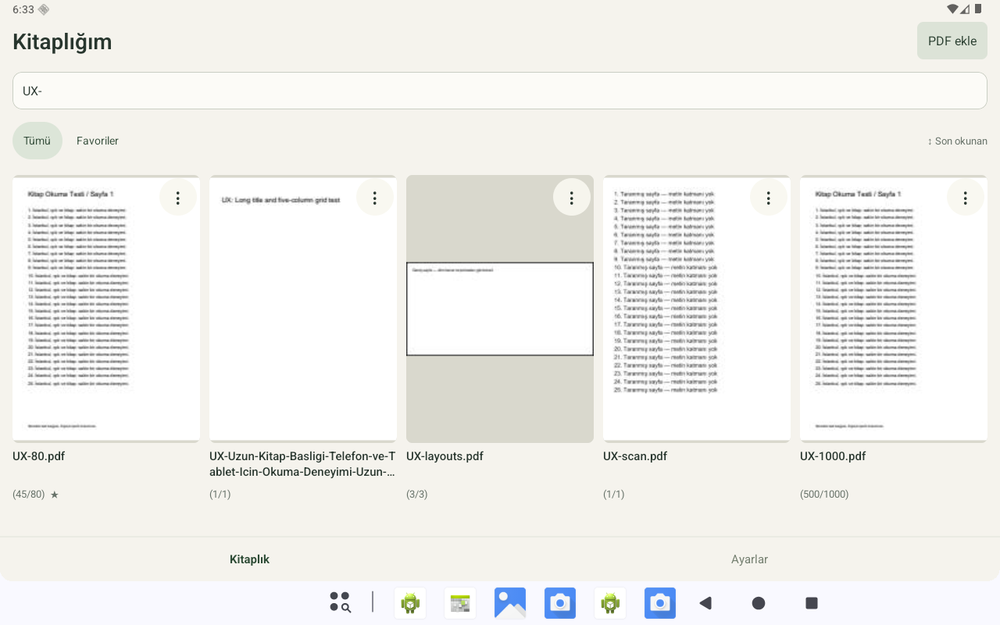
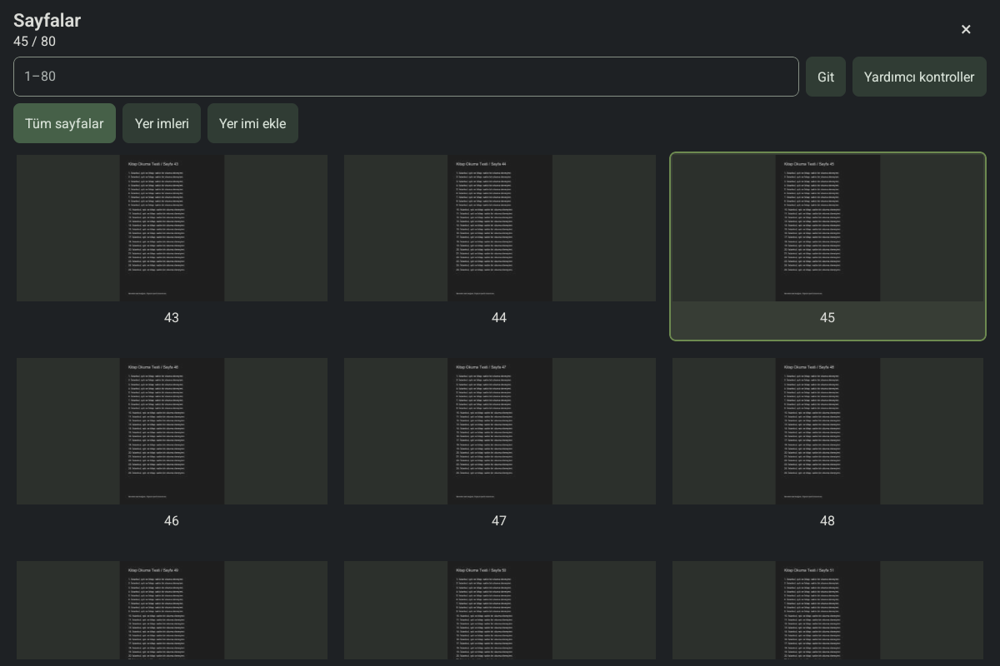

# UX-MVP-6 — final arayüz, genel kontrol ve APK

15 Ekim 2026. Sürüm **0.8.0 / versionCode 15**, `com.kitap`, SQLite 7,
yedek v2 (v1 okunur). Kaynak ve imzalı release derlemeleri hazırdır. Bu rapor
belirtilen host/emülatör kapsamını belgeler; fiziksel Huawei ve tam V1 kabulü açık kalır.

## Son davranış

Kitaplık tek sanal kaydırma alanında kapak ızgarasıdır. Kartta iki satırlık başlık,
`(45/80)` ve ⋮ bulunur; menü yalnız Notlar / Altı çizilenler / Favoriye ekle–çıkar.
Arama, favori filtresi ve ayrı sıralama birlikte çalışır. Yönetim ana Ayarlar'dadır.

Okuyucu başlıksız tam ekrandır. Sayfa normal ölçekte kırpılmadan/oranı korunarak sığar;
boşluk aynı sayfa arka planıdır. Dokunma katmanı PDF'yi küçültmeden sayfa notu / kitap
notu / metin seçimi ve ayrı Sayfalar simgesini gösterir. Görünüm ayarları ana Ayarlar'da
ortaktır. Eski kitap ayarları veride korunur. Kapatma son gösterilen konumun DB kaydını bekler.

Metin işaretleri yeni/eski bütün kayıtlarda `highlight/#FFEB3B`, alpha82/255'tir.
Satır quad'ları filtre sonrasında tek Path ile çizilir; kesişme koyulaşmaz. Eski tür/renk
kurtarma tablosundadır; kimlik/alıntı/geometri/tarih/not bağı korunur. Region dönüşmez.
Orijinal PDF değiştirilmez. Seçim menüsü Sarıyla işaretle / Kopyala / Pasaja not ekle /
Seçimi kapat; metinsiz taramada bölge işareti vardır.

Native host tek/çift sayfada pointer sahipliğini yönetir. Swipe parmağı izler ve
aynı ofsetten tamamlanır; zoom'da pan, iki parmakla 1–5× zoom ve çift dokunma vardır.
1×'e dönmek yeterli değildir: ilave %18 sıkıştırma hazırlar, %10 üstüne geri açma iptal
eder, bırakma üç sütun genel görünümü açar. Scroll konum yazmaz; seçilen sayfa native
presentation sonrasında kaydedilir. Her iki OS kenarının inset koruması korunur.

## Final aşamada düzeltilen regresyonlar

- Native thumbnail/PDF `Canvas.drawColor` komşu hücreleri boyayabiliyordu.
  İki View'in çizimi açık `clipRect` ile sınırlandı. Final screenshot testinde yalnız
  erişilebilirlik bounds'u değil, fiziksel gutter pikselleri ve sayfa numaraları doğrulandı.
- Çift sayfada yardımcı zoom/reset komutu iki pane'e birden gider. Double-tap ve
  annotation odağı peer hazır olmasını gözetir. Bu bekleme yalnız olay sonrası çalışır.
- Dar ekranda/büyük yazıda panelin üst bölümü sınırlı kaydırılır; kapat sabit,
  sayfa ızgarası erişilebilir kalır. Görünmeyen PDF kontrolleri odağa girmez.

## İmzalı teslim

| Paket | ABI | Boyut | SHA-256 |
|---|---|---:|---|
| [ARM64 APK](../../../artifacts/ux-mvp-6/kitap-uxmvp6-arm64-v8a.apk) | arm64-v8a | 23.069403 MiB | `4f7efdb977306ddf849a9cfe306f86bac115e609dc82fd085380315f3dec0db5` |
| [Universal APK](../../../artifacts/ux-mvp-6/kitap-uxmvp6-universal.apk) | arm64-v8a, x86_64 | 42.208096 MiB | `13337ff2a725a079379bfa9174e111ac74abde1cb47eab4c83a5f551c1f7160f` |

İmza sertifikası SHA-256:
`1a1f883707fe5009a8c25582a2ca0fa9ee55c844d802936f4b311a8a2502dc5c`.
Önceki sürümlerle aynı uygulama/imza; kaldırmadan güncellenir. Anahtar/parola repoda yoktur.

R8/resource shrink sonrası JNI/DEX ve Codegen bağlantısı, iki ABI, ELF+ZIP 16 KB statik
hizalama, imza ve izin denetimi geçti. INTERNET veya geniş depolama izni yoktur. Hermes/JS
paketlidir; testlerde Metro kapalıdır. Runtime emülatör 4 KB sayfa boyutundadır; statik
16 KB sonucu gerçek 16 KB cihaz testi değildir. 32 bit ABI bu teslimde yoktur.

## Otomasyon ve gerçek emülatör kapsamı

**95 native host + 31 Jest = 126 test geçti.** TypeScript strict ve ESLint geçti.
Migration/rollback/idempotence, eski stiller ve v1/v2 yedek, transaction/revision,
koordinat/quad dönüşümü, page/spread sınırları, gesture eşikleri/cancel, cache ve generation
kuralları kapsanır. RN testlerinde kitaplık/overlay/overview ve iki pane zoom komutu vardır.
Aynı senaryonun derleme sırasında tekrar çalışması toplam teste ikinci defa eklenmedi.

Final universal APK Android16/API36 x86_64 `kitap-functional` emülatörde çalıştırıldı.
Gerçek RAM yaklaşık 3920 MiB'dir; emulator `-memory 2048` isteğini 4096'ya yükseltti.
Bu ortam 2 GB Huawei olarak etiketlenmedi. Shell dokunma sürücüsü test aracıdır;
uygulamaya paketlenmez, uygulamaya `INJECT_EVENTS` izni verilmez.

- İndirilenler'deki **10 mevcut PDF / toplam12 sayfa** açıldı. Her dosyada gösterilen
  fiziksel sayfa ile SQLite son konumu eşleşti. Kişisel dosyalar yalnız DL01–DL10
  takma adıyla raporlanır; kaynak PDF, not/alıntı ve kapak ekranları repoya konmadı.
- Sentetik1000 sayfalı gerçek PDF'de500'e git → overview'de farklı satıra kaydır →
  kapat akışı500'ü korudu. Bu koşuda thumbnail cache'e12 yeni kayıt eklendi;
  bütün1000 küçük resim üretilmedi. Bu disk kayıt sayısı RAM/p95 ölçümü değildir.
- Metinsiz bitmap PDF'de kelime seçimi taklit edilmedi; manuel region kaydı oluştu.
- Geniş, çok sütunlu/eğik yazılı ve döndürülmüş3 test sayfası açıldı. Bozuk PDF import'u
  hazır kitap oluşturmadı. Bu sayfaları açmak bütün eğik/RTL işaretleme matrisinin kabulü değildir.
- Kitaplık360/600/900/1280 dp pencerelerde2/3/4/5 sütun verdi. Uzun başlık ve son
  satır sabit kart genişliği korundu.360×480 pencere ve%200 yazıda kapat/ızgara erişilebilirdi.
- Menü yalnız izinli işlemleri gösterdi; PDF ölçüsü değişmedi. Final üç sütun görüntüsünde
  gutter ve fiziksel sayfa numaraları görünür kaldı.

## Son birleşik kayıt ve hareket kontrolleri

- İki pane'e yayılan pinch ve geri/reset sonrası iki sayfanın görüntüsü başlangıçla
  birebir eşleşti (karşılaştırılan alanda değişen piksel oranı0). Çift dokunma/geri ve
  kitap kapatmada fiziksel sayfa korundu.
- Yeni sarı işaret + pasaj notu oluşturuldu; uygulama force-stop/reopen sonrasında
  aynı45. sayfada kaldı.2 yeni metin işareti ve1 ilişkili not kaydedildi. Ekranda iki
  ayrı satır bandında toplam1510 sarı tonlu piksel görüldü; bu bir performans ölçümü değildir.
- Yakınlaştırmadan yalnız1×'e dönüş overview açmadı. Ek sıkıştırma açtı; kapatınca
  fiziksel sayfa korundu. Eşik/geri açılma/system-cancel varyasyonları host testlerinde vardır.
- Kayıtlı işaretin piksel merkezi parmak sürüklenirken250px ilerledi. ACTION_CANCEL
  sonrasında görüntü eski konuma döndü ve son kayıt45 kaldı.
- Son başarılı taslak commit'i uygulama force-stop sonrasında Notlar'dan açıldı ve
  explicit Kaydet ile nota dönüştürüldü.
- Gerçek SAF akışıyla v2 JSON oluşturuldu; favori yerelde değiştirildi. Yereli koru
  yerel değeri tuttu, yedeği kullan yedekteki değeri geri getirdi. İki restore sonunda
  kitap/işaret/not/taslak/yer imi sayıları değişmedi.
- Kurulu APK'nın SHA-256'sı final universal dosyayla birebir eşleşti. Eski3 kullanıcı
  notunun kimlik/başlık/metin/kapsam/işaret bağı ve eski2 işaretin kimlik/alıntı/sayfa/tarihi
  önceki private DB ile karşılaştırıldı ve korundu. Son durumda15 kitap,7 işaret,6 not,
  0 taslak,1 yer imi vardır; farklar eklenen sentetik test kayıtlarıdır.
- 1280 dp boyut değişiminden sonra sistem görev çubuğunun geçici animasyonu durulduğunda
  Ayarlar ve Kitaplık sekmelerine gerçek dokunma çalıştı; final tablet ekranı bu durulmuş görüntüdür.
- Son boot crash tamponunda uygulama Java/native crash kaydı, events tamponunda
  uygulama ANR kaydı bulunmadı. Bu sınırlı log gözlemi tam uzun oturum/OOM kabulü değildir.

Otomasyonun bazı ön denemeleri yanlış SAF alanı/uzun sorgu ve Android'in büyük harfli
SAVE etiketi nedeniyle durdu. Bu denemeler başarılı ürün testi sayılmadı; gerçek ekran
etiketiyle sürücü düzeltilip ilgili senaryo tekrar yürütüldü. İlk hatalar ve ham tanılama
özel test klasöründe tutuldu. UX5 gerçek native boya hatası ayrıca yukarıda belgelenmiştir.

## Performans ve açık kabul kapıları

[Canonical bütçe sonucu](UX-MVP-6-budget-evaluation.json) **INCOMPLETE**.
[Ölçüm girdisinde](UX-MVP-6-measurements.json) yalnız gerçek APK boyutları vardır;
ARM64≤30 / universal≤50 MiB hedefleri geçti. Emülatör kitaplık sonrası tek PSS noktası
70951 KiB idi. Ayrı üç emülatör noktasında fit71608 / zoom76490 / overview82270 KiB
PSS görüldü. Bunlar tipik/peak/uzun oturum veya Huawei kabul ölçümü değildir.
Otomasyonun ADB/UiAutomator beklemeleri kullanıcı gecikmesi/p95 diye kullanılmadı.

[Yeniden açılmış sarı işaret ekranı](../screenshots/ux6-yellow.png).

Fiziksel Huawei API/ABI/RAM ölçümü, ARM64 çalışma, 30–60 dk/500 geçiş/20 zoom/10 yön
kontrolü, p95/FPS/frozen-frame/PSS/uzun oturum ölçümleri açık. TalkBack servisi bu emülatörde
kurulu değildir; erişilebilirlik ağacı/düğme alternatifleri ve%200 font, gerçek TalkBack
kabulünün yerini tutmaz. Predictive-back iptali ve iki OS geri kenarının normal/zoom/seçim/
panel/IME matrisinin fiziksel testi açık. Shell edge enjeksiyonu sistem Ayarlar kontrolünde
de OS geri üretmediğinden başarılı sistem geri kanıtı sayılmadı.

Ağır vektör/yüksek çözünürlük tarama/RTL, uzak sağlayıcı/SD, gerçek disk dolması ve gerçek
split-screen matrisi genişletilmelidir. Tam bütün-tema ve döndürülmüş/çok sütunlu işaret
okunabilirliği fiziksel görsel incelemesi açık kalır. Mevcut npm build/test bağımlılık
bildirimleri [önceki MVP-6 raporunda](MVP-6.md) izlenir; yeni ağır UI/PDF bağımlılığı eklenmedi.

Makine kayıtları: [teslim manifesti](UX-MVP-6-delivery.json), [işlev senaryoları](UX-MVP-6-functional.json),
[Jest](UX-MVP-6-jest.json), [native JUnit](UX-MVP-6-junit-summary.json),
[ARM64 doğrulama](UX-MVP-6-verification.json), [universal doğrulama](UX-MVP-6-universal-verification.json).
[Kullanım/güncelleme](../../KULLANIM_VE_KURTARMA.md), [destek](../../DESTEK_MATRISI.md),
[mimari](../../architecture/UX_READER.md). Önceki APK/raporlar korunmuştur.

## 50 kriter için kanıt ve açık sınırlar

Bu tablo tüm kriterleri geçmiş ilan etmez. Host, gerçek emülatör senaryosu ve
fiziksel kabul ayrıdır. [Makine okunur tam beklenti/kanıt haritası](UX-MVP-6-criteria.json).

| ID | Kanıt ve açık sınır |
|---|---|
| U1-01 | Emülatör360/600/900/1280 dp:2/3/4/5 sütun; gerçek split-window matrisi açık. |
| U1-02 | Uzun başlık ve son satır görsel kontrolü; eksik kapak placeholder yolu host/RN kapsamı. |
| U1-03 | UX1 karttan başlayan gerçek kaydırma; final tek FlatList korunur. |
| U1-04 | UX1 üç işlem/aç-kapat; final RN menü testi. Fiziksel TalkBack ayrı. |
| U1-05 | UX1 yeniden başlatmada favori; native transaction/hata ve sorgu testleri. |
| U1-06 | Native birleşik query ve RN arama/filtre/sıralama testleri. |
| U1-07 | Gerçek80 sayfalı PDF45→kapat→kart→45; final basic akışı. |
| U1-08 | Final 1000 sayfalı overview scroll/close500; gesture cancel host ve emülatör kanıtı. |
| U1-09 | Host silme/relink/backup regresyonu; eski kullanıcı kayıtları güncellemede korunur. |
| U2-01 | Final reader screenshot: başlık/tutamaç/sayaç/alt sekme yok. |
| U2-02 | Host viewport dönüşümleri ve final farklı oranlı3 sayfa; ağır corpus açık. |
| U2-03 | Final tam sayfa screenshot ve native paper rengi; tema matrisi fiziksel açık. |
| U2-04 | Final1200×800 screenshot üst%80 PDF pikselleri overlay öncesi/sonrası aynı. |
| U2-05 | Final gerçek overlay yalnız izinli işlemler; RN testi. |
| U2-06 | Ortak ayar native/RN testleri ve UX2 Gece ayarının sonraki kitaplarda kullanılması. |
| U2-07 | Native/RN focus ve görünürlük; gerçek TalkBack/insets matrisi açık. |
| U2-08 | Viewport/spread host ve pencere genişlikleri; gerçek live split-screen/rotation matrisi açık. |
| U3-01 | Final yeni sarı işaret/pasaj kaydı ve yeniden açılmış iki bandın1510 piksel kontrolü. |
| U3-02 | Final force-stop/reopen aynı45. sayfa ve sarı işaretler; DB/not bağlantısı doğrulandı. |
| U3-03 | Migration/rollback/revision/restore host; eski not/anchor kimlikleri upgrade karşılaştırması. |
| U3-04 | TextGeometry/quad host;3 farklı test sayfası açıldı; çok sütun/rotated işaret görsel matrisi açık. |
| U3-05 | Ortak native transform/overlay ve swipe kanıtı; zoom/rotation tam fiziksel matrisi açık. |
| U3-06 | Gece sarı görünümü doğrulandı; bütün temaların fiziksel okunabilirlik kontrolü açık. |
| U3-07 | Sil/undo/ilişkili not/jump host regresyonları; tam final fiziksel akış açık. |
| U3-08 | AnnotationRepository idempotent transaction, hata/retry host testleri. |
| U3-09 | Final gerçek bitmap tarama: manual-region; sahte kelime seçimi yok. |
| U3-10 | NoteRepository host; gerçek draft force-stop/reopen/save ve eski notların korunması. |
| U4-01 | Final saved-highlight250px parmak takibi/cancel;220ms settle sınırı host. FPS/p95 açık. |
| U4-02 | GesturePolicy host, UX4 kısa iptal; final cancel akışı ayrı kayıtta. |
| U4-03 | PageIndex/Spread ilk-son sınır host; bütün fiziksel sınır hareketleri açık. |
| U4-04 | UX4 gerçek zoom-pan; final iki pane pinch/reset. |
| U4-05 | GesturePolicy/host pointer kuralları; UX4 kalan parmak testi; fiziksel varyasyonlar açık. |
| U4-06 | Final işaretin piksel merkezi swipe ile250px hareket etti; cancel geri döndü. |
| U4-07 | Generation/cache/queue host ve force-stop; hareket ortasında rotation/background tam matrisi açık. |
| U4-08 | İki kenar inset guard uygulandı/testli; OS/predictive-back tam fiziksel matrisi açık. |
| U5-01 | Final gerçek pinch: yalnız1× dönüş açmadı. Host eşik testi. |
| U5-02 | Final ek pinch üç sütunu açtı; %18/%10/cancel host. Sistem iptali fiziksel matrisi açık. |
| U5-03 | Final görsel üç sütun/current row; gutter/sayfa numarası piksel kontrolü. |
| U5-04 | Gerçek1000 sayfa: sınırlı görünür thumb talepleri, cache kaydı+12; RAM bütçesi ayrı. |
| U5-05 | Final 1000 sayfa scroll/close500; zoom/odak komutu göndermeme RN testi. |
| U5-06 | Native presentation→DB bariyeri ve gerçek numarayla jump/reopen. |
| U5-07 | RN placeholder tıklama ve kapanış sonrası seçim testi; numarayla gerçek gitme. |
| U5-08 | Gerçek Sayfalar simgesi/geri ve erişilebilir düğmeler; TalkBack servisi testi açık. |
| U6-01 | Belirtilen corpus/kayıt kapsamı; bütün PDF çeşitlerinde veri/konum garantisi verilmez. |
| U6-02 | Aynı imzayla emulator install-r9→10→11→12→13→14→15; fiziksel upgrade açık. |
| U6-03 | Host v1/v2 normalize/dedupe/restore; final v2 iki çatışma seçeneği ve sabit kayıt sayıları. |
| U6-04 | Final boot crash/events tamponunda uygulama crash/ANR yok; OOM/uzun fiziksel oturum kabulü açık. |
| U6-05 | %200 font ve a11y tree/düğmeler; gerçek TalkBack ve tüm reduced-motion matrisi açık. |
| U6-06 | İmzalı bundled release, testlerde Metro kapalı; INTERNET izni yok. |
| U6-07 | Huawei/2 GB/performance kabulü açık tutuldu; canonical sonuç INCOMPLETE. |

## Sentetik PDF ekranları

Bu görüntüler yalnız üretilmiş test kitaplarını içerir. Kişisel kitap ekranları paylaşılmadı.

[Telefon kitaplığı](../screenshots/ux6-library-phone.png) · [Tam ekran](../screenshots/ux6-reader.png) · [Transparan katman](../screenshots/ux6-overlay.png) · [%200 yazı](../screenshots/ux6-font200.png).

Testlerin kaynak sürücüleri ve tekrar adımları [Android regresyon araçlarında](../../../scripts/android-test/README.md). Release scriptleri varsayılan olarak UX-MVP-6’ya çıktı verir; eski MVP-6 artifact'ı varsayılan yeniden derlemeyle ezilmez.
